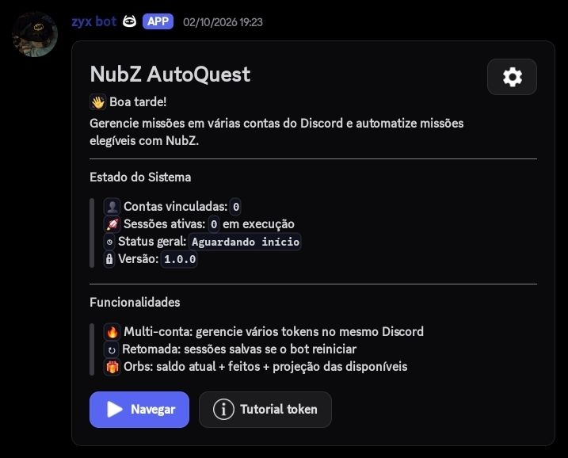
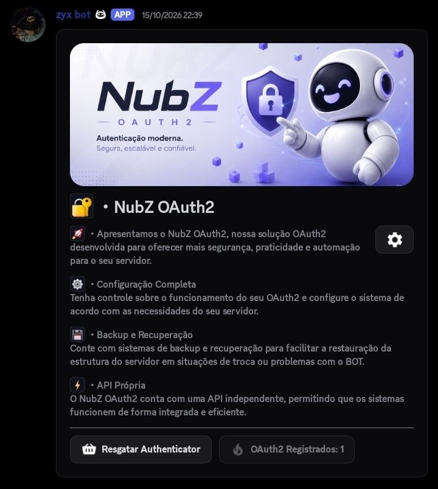

# ZyXBot — configuração

## Prévia do bot

### Painel AutoQuest



### Painel OAuth2



## 1. Requisitos

- Node.js 22 ou superior e npm.
- Aplicação e bot criados no [Discord Developer Portal](https://discord.com/developers/applications).
- Um servidor Discord onde você possa adicionar o bot.

## 2. Instalar dependências

Na pasta do projeto, execute:

```bash
npm install
```

## 3. Configurar `config.json`

Crie o arquivo local `config.json` usando o modelo e preencha seus próprios valores:

```bash
cp config.example.json config.json
```

Em seguida, edite `config.json` localmente. Não o publique. Exemplo de estrutura:

```json
{
  "BOT_TOKEN": "TOKEN_DO_BOT",
  "DISCORD_CLIENT_ID": "ID_DA_APLICACAO",
  "GUILD_ID": "ID_DO_SERVIDOR",
  "DEPLOY_SCOPE": "guild",
  "AUTO_DEPLOY": true,
  "OAUTH2_REDIRECT_URI": "https://SEU_DOMINIO/api/login",
  "OAUTH2_PUBLIC_URL": "https://SEU_DOMINIO",
  "OAUTH2_PORT": 8080,
  "OAUTH2_API_TOKEN": "TOKEN_API_FORTE",
  "OAUTH2_ENCRYPTION_KEY": "CHAVE_DE_CRIPTOGRAFIA_FORTE",
  "OAUTH2_SCOPES": ["identify", "email", "guilds.join"],
  "owners": ["SEU_ID_DISCORD"]
}
```

| Campo | O que informar |
|---|---|
| `BOT_TOKEN` | Token do bot, disponível na página **Bot** da aplicação no Developer Portal. |
| `DISCORD_CLIENT_ID` | ID da aplicação, disponível em **General Information**. |
| `GUILD_ID` | ID do servidor para registro de comandos no servidor durante a configuração inicial. |
| `DEPLOY_SCOPE` | `guild` para escopo de servidor ou `global` para comandos globais. |
| `AUTO_DEPLOY` | `true` para permitir o registro automático de comandos conforme o fluxo do projeto. |
| `OAUTH2_REDIRECT_URI` | URL pública de callback OAuth2, terminando em `/api/login`. |
| `OAUTH2_PUBLIC_URL` | URL pública base do serviço HTTP do gerenciador. |
| `OAUTH2_PORT` | Porta do serviço HTTP; o padrão é `8080`. |
| `OAUTH2_API_TOKEN` | Segredo forte usado para proteger a API do gerenciador. |
| `OAUTH2_ENCRYPTION_KEY` | Chave secreta forte para a configuração de criptografia do gerenciador. |
| `OAUTH2_SCOPES` | Escopos OAuth2 solicitados. Configure apenas os necessários. |
| `owners` | Lista de IDs de usuário do Discord com acesso de proprietário. |

Para obter um ID do Discord, ative o **Modo Desenvolvedor** em Configurações → Avançado e use **Copiar ID** no usuário ou servidor desejado.

## 4. Configurar o Discord Developer Portal

1. Na aplicação, abra **Bot** e copie o token para `BOT_TOKEN`.
2. Em **OAuth2 → General**, configure a URL de redirecionamento exatamente igual ao valor de `OAUTH2_REDIRECT_URI`.
3. Em **Bot → Privileged Gateway Intents**, habilite os intents privilegiados necessários ao projeto, especialmente **Server Members Intent** e **Message Content Intent**.
4. Convide o bot ao servidor com os escopos e permissões exigidos pelos recursos que você pretende usar. Conceda somente as permissões necessárias.
5. Se for usar o gerenciador OAuth2 fora da máquina local, disponibilize o serviço por HTTPS e configure `OAUTH2_PUBLIC_URL` e o callback com o domínio público correto.

## 5. Iniciar

```bash
npm start
```

Para desenvolvimento com reinicialização automática ao alterar arquivos:

```bash
npm run dev
```

**By tzx dev**
